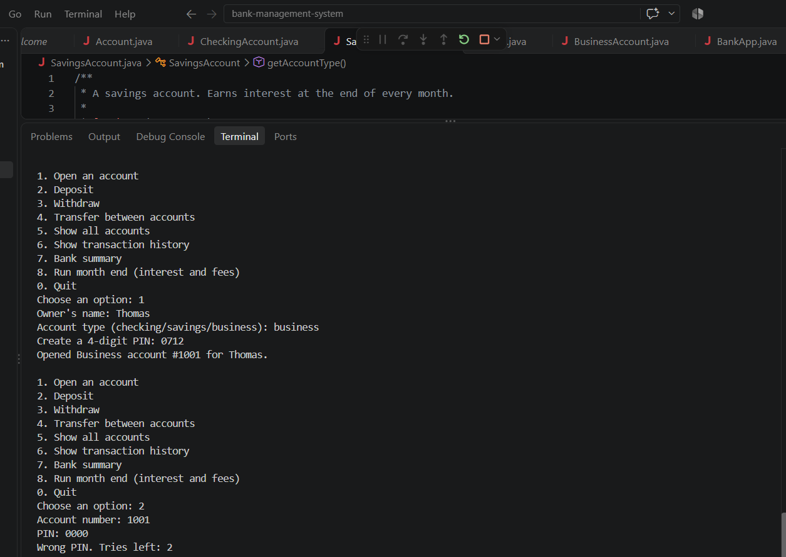

# Bank Management System

A Java console banking app with checking, savings, and business accounts. Since I handle payment issues at work, I built in fraud flagging and PIN security.

## Features
- Checking, savings, and business accounts, each with its own month-end rule (fees or interest)
- 4-digit PIN login that locks the account after 3 wrong tries
- Deposits, withdrawals, and transfers between accounts
- Fraud flagging: any withdrawal or transfer over 50% of the balance must be confirmed and is marked FLAGGED in the history
- Transaction history for every account
- Bank summary: total money, largest account, and number of flagged transactions

## Java concepts used
Inheritance, abstract classes and methods, polymorphism, encapsulation (private fields with getters), method overriding, ArrayList, switch menus, and try/catch for bad input

## How to run
1. Download all 6 .java files into one folder
2. Run `javac *.java`
3. Run `java BankApp`

## What I'd add next
- Save accounts to a file or database so they're kept after closing
- A graphical interface or website

